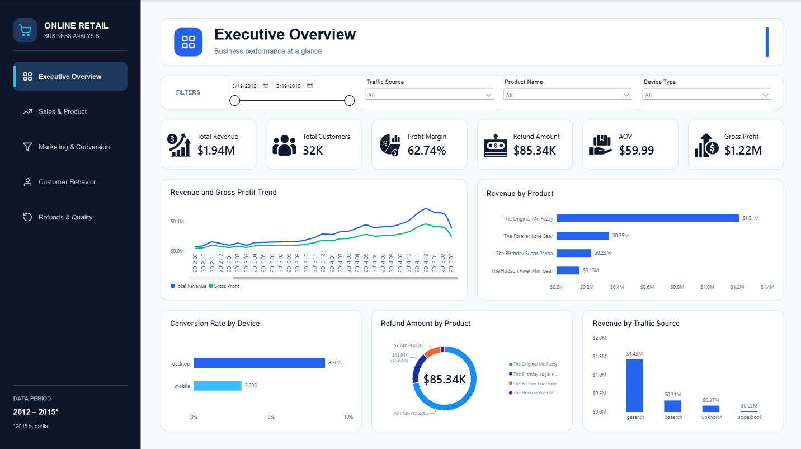
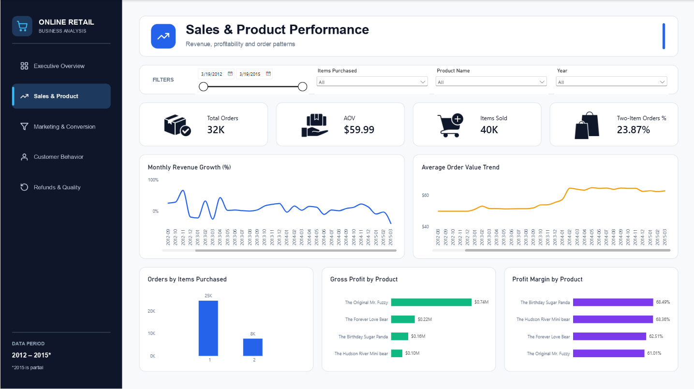
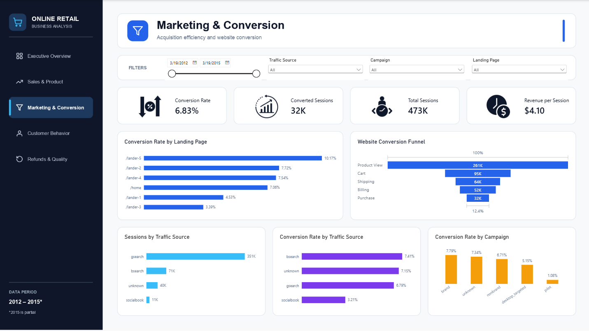
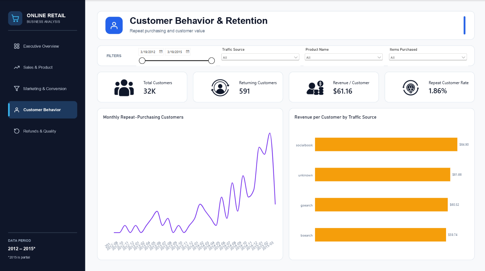
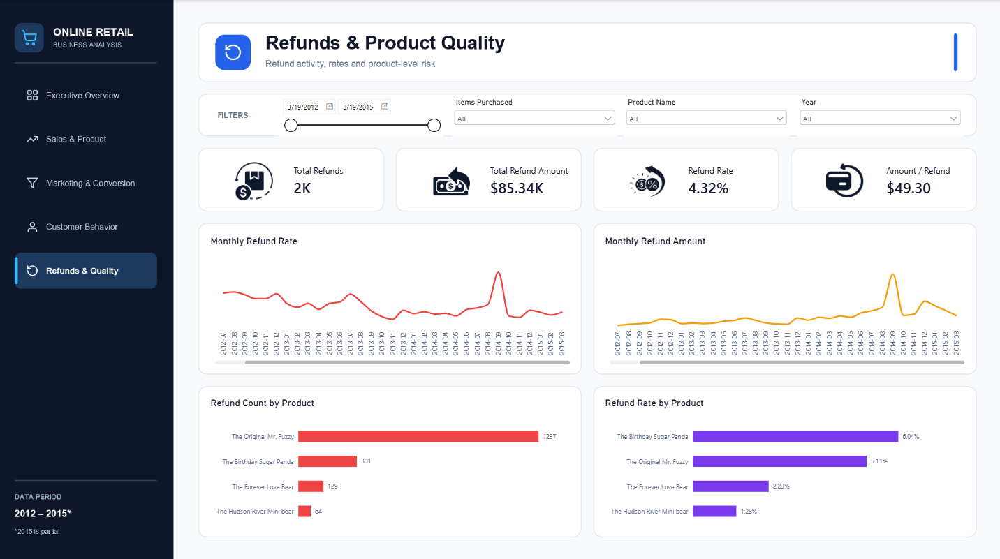

# Online Retail Business Analysis
### End-to-End Data Analytics Project | SQL · Excel · Python · Power BI

An end-to-end e-commerce analytics project focused on sales performance, product profitability, customer retention, marketing effectiveness, website conversion, and refunds.

This project follows the complete analytics workflow, from raw data loading and cleaning to exploratory analysis, business insights, and interactive Power BI dashboards.

The objective was not just to visualize numbers, but to understand what the data reveals about business performance and identify areas worth investigating.

---

## Project Overview

| Project Component | Description |
|---|---|
| Domain | E-commerce and Online Retail |
| SQL | Data loading, cleaning, validation, and business analysis |
| Excel | Data exploration and interactive dashboard |
| Python | Data profiling, cleaning, transformation, and exploratory data analysis |
| Power BI | Data modeling, DAX measures, and five interactive dashboards |

### Business Questions

- How are revenue, orders, and profitability performing?
- Which products contribute most to revenue and gross profit?
- How does conversion differ between desktop and mobile?
- Which landing pages and marketing segments perform differently?
- What does the data reveal about returning customers?
- Which products account for the largest refund amounts and rates?
- How can these findings guide further business investigation?

---

## Key Business Findings

The following findings emerged from the analysis. They describe observed patterns in the dataset and should not be interpreted as proof of their underlying causes.

### 1. Sales and Profitability

| Metric | Result |
|---|---:|
| Gross Revenue | $1,938,509.75 |
| Gross Profit | $1,216,139.50 |
| Gross Margin | 62.74% |
| Total Orders | 32,313 |
| Average Order Value | $59.99 |
| Total Customers | 31,696 |

**Business insight:** Revenue alone does not provide a complete picture of performance. Tracking gross profit, margin, and average order value together provides a stronger foundation for understanding business performance.

### 2. Desktop vs. Mobile Conversion

| Device | Conversion Rate |
|---|---:|
| Desktop | 8.50% |
| Mobile | 3.09% |

Desktop conversion was approximately 2.75 times the mobile conversion rate, a difference of 5.41 percentage points.

**Business insight:** The gap warrants further investigation into mobile usability, page performance, checkout friction, and differences in visitor intent. The analysis identifies an opportunity to investigate, not a proven cause.

### 3. Customer Retention

| Metric | Result |
|---|---:|
| Total Customers | 31,696 |
| Returning Customers | 591 |
| Returning Customer Rate | 1.86% |

**Business insight:** The overall analysis classified approximately 1.86% of customers as returning customers. Cohort analysis, time-to-second-purchase analysis, and channel-level retention comparisons could help explain repeat-purchasing behavior.

### 4. Product Revenue and Refunds

Original Mr. Fuzzy generated approximately $1.21 million in product revenue and accounted for 72.46% of total refund value.

| Product | Refund Amount | Share of Refund Value |
|---|---:|---:|
| Original Mr. Fuzzy | $61,837.63 | 72.46% |
| Birthday Sugar Panda | $13,842.99 | 16.22% |
| Forever Love Bear | $7,738.71 | 9.07% |
| Hudson River Mini bear | $1,919.36 | 2.25% |
| **Total** | **$85,338.69** | **100%** |

Birthday Sugar Panda had the highest reported refund rate among these products at approximately 6.04%.

**Business insight:** The product with the highest refund amount is not necessarily the product with the highest refund rate. Sales volume, refund rate, and refund value should be assessed together when prioritizing product-quality investigations.

### 5. Landing Page Performance

| Landing Page | Sessions | Orders | Conversion Rate |
|---|---:|---:|---:|
| /lander-5 | 68,166 | 6,930 | 10.17% |
| /lander-2 | 131,170 | 10,128 | 7.72% |
| /lander-4 | 9,385 | 708 | 7.54% |
| /lander-1 | 47,574 | 2,157 | 4.53% |
| /lander-3 | 79,000 | 2,679 | 3.39% |

**Business insight:** Landing-page conversion varied considerably. Comparing traffic sources, device mix, and visitor behavior could help identify why performance differs before deciding whether to redesign or test a page.

### 6. Marketing Performance

The analysis also revealed differences across traffic sources, campaigns, and devices.

| Segment | Observed Result |
|---|---:|
| Brand campaign conversion | 7.79% |
| Pilot campaign conversion | 1.08% |
| Socialbook conversion | 3.21% |
| Desktop conversion | 8.50% |
| Mobile conversion | 3.09% |

**Business insight:** Traffic volume and conversion efficiency should be considered together. Marketing investment decisions would require additional information such as advertising spend, acquisition cost, and campaign profitability.

### Important Data Context

The available 2015 data covers January through March only. Comparisons with complete calendar years must account for this partial period.

Headline metrics may differ across SQL, Python, and Power BI because of differences in data grain, definitions, filters, and relationship behavior. The values above are from the overall analysis summaries, not guaranteed results under every Power BI slicer selection.

---

## Power BI Dashboard Gallery

The final Power BI report contains five interactive dashboard pages designed to provide different views of business performance.

### 1. Executive Overview

A high-level view of revenue, customers, average order value, gross profit, profit margin, and refund value.



### 2. Sales and Product Performance

Explores sales trends, order characteristics, product revenue, gross profit, and product-level profitability.



### 3. Marketing and Conversion

Examines website sessions, conversion rates, traffic sources, campaigns, landing pages, and funnel stages.



### 4. Customer Behavior and Retention

Focuses on customer counts, returning customers, revenue per customer, and repeat-purchasing patterns.



### 5. Refunds and Product Quality

Analyzes refund counts, refund amounts, refund rates, and differences between products.



The dashboards include relevant slicers for dimensions such as date, product, traffic source, device, campaign, landing page, and items purchased.

---

## Tools and Technologies

| Tool | Application |
|---|---|
| SQL | Data loading, cleaning, validation, and analytical queries |
| Excel | Spreadsheet analysis and dashboard reporting |
| Python | Data profiling, transformation, and exploratory analysis |
| Pandas | Data manipulation and analysis |
| Matplotlib and Seaborn | Data visualization |
| Power BI | Interactive business intelligence reporting |
| DAX | Measures, KPIs, and time-based calculations |
| Power Query | Data preparation and transformation |
| Data Modeling | Relationships across sales, products, refunds, sessions, and pageviews |

---

## Project Workflow

### Phase 1: SQL

- Database and table preparation
- Data loading, cleaning, and validation
- Business growth and sales analysis
- Customer and profitability analysis
- Product performance and refund analysis
- Marketing and website behavior analysis

Explore the SQL scripts and `SQL_Analysis_Summary.md` in `02_SQL/`.

### Phase 2: Excel

- Data exploration and spreadsheet analysis
- Pivot tables and business metrics
- Interactive dashboard reporting

Explore the workbook and dashboard screenshots in `03_Excel/`.

### Phase 3: Python

- Data loading and profiling
- Data cleaning and transformation
- Exploratory data analysis
- Visual exploration of business patterns

Explore the notebooks and `Python_Analysis_Summary.md` in `04_Python/`.

### Phase 4: Power BI

- Data model development
- Relationships across six cleaned datasets
- DAX measures for sales, conversion, retention, and refunds
- Time-based comparisons
- Five interactive dashboard pages
- Business findings and interpretation

Explore `online_retail_business_analysis.pbix` and `PowerBI_Analysis.md` in `05_PowerBI/`.

---

## Repository Structure

```text
Online_Retail_Business_Analysis/
│
├── 01_Data/
│   ├── Processed_Data/
│   │   ├── order_item_refunds_clean.csv
│   │   ├── order_items_clean.csv
│   │   ├── orders_clean.csv
│   │   ├── products_clean.csv
│   │   ├── website_pageviews_clean.csv
│   │   └── website_sessions_clean.csv
│   │
│   └── Raw_Data/
│       ├── maven_fuzzy_factory_data_dictionary
│       ├── order_item_refunds.csv
│       ├── order_items.csv
│       ├── orders.csv
│       ├── products.csv
│       ├── website_pageviews.csv
│       └── website_sessions.csv
│
├── 02_SQL/
│   ├── 1_Data_Load_and_Cleaning/
│   ├── 2_Analysis/
│   └── SQL_Analysis_Summary.md
│
├── 03_Excel/
│   ├── Dashboards/
│   └── Workbook/
│
├── 04_Python/
│   ├── 01_data_loading_and_profiling.ipynb
│   ├── 02_data_cleaning_and_transformation.ipynb
│   ├── 03_exploratory_data_analysis.ipynb
│   └── Python_Analysis_Summary.md
│
└── 05_PowerBI/
    ├── Dashboard_Images/
    │   ├── 1_Executive_Overview.png
    │   ├── 2_Sales_and_Product_Performance.png
    │   ├── 3_Marketing_and_Conversion.png
    │   ├── 4_Customer_Behavior_and_Retention.png
    │   └── 5_Refunds_and_Product_Quality.png
    │
    ├── PowerBI_Analysis.md
    └── online_retail_business_analysis.pbix
```

---

## Limitations and Interpretation

- The findings describe observed patterns and do not establish causation.
- Conversion rates can be affected by traffic mix, visitor intent, and other factors not isolated in the analysis.
- Refund amount and refund rate measure different aspects of product performance.
- Funnel stage counts should not be treated as a verified sequential journey unless the same session cohort and stage progression have been validated.
- Returning-customer metrics depend on their definition and filter context.
- The available 2015 data covers January through March only.
- Financial impact, cost savings, and revenue uplift have not been claimed without a validated calculation or experiment.

## Conclusion

This project demonstrates an end-to-end data analytics workflow using SQL, Excel, Python, and Power BI.

It combines data preparation, exploratory analysis, business metrics, and interactive reporting to investigate sales performance, marketing conversion, customer retention, and product refunds.

More importantly, it demonstrates how an analyst can move beyond describing numbers to identify business questions, quantify observed differences, and recommend areas for further investigation.

**The goal is not just to report what happened, but to understand what the data suggests should be investigated next.**
